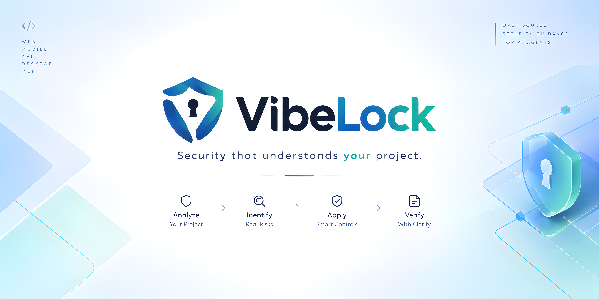

# VibeLock

**Build fast. Secure by default.**

VibeLock is a project-aware security framework for AI-assisted software development. It is a skill: a set of Markdown instructions that makes an AI coding agent understand your project first (purpose, stack, data, users, exposure), work out what security it actually needs, plan it, get your approval, implement it, verify it with evidence, review its own changes, and report honestly what was and was not checked.

It adapts to the project. A static brochure site and a payments backend get different plans, and an agent following VibeLock is expected to explain why each control applies and to say "this doesn't apply here" when it doesn't.

## What VibeLock is not

- Not a vulnerability scanner. It runs no scans by itself. The agent runs whatever checks exist in your environment and reports what ran.
- Not a checklist applied to every project, and not a collection of prompts.
- Not a certification or guarantee. Risk tiers guide how deeply a project is reviewed. A project at any tier can still be breached.
- Not a replacement for a security professional, a penetration test, or compliance advice.
- Not a CLI. There is no `vibelock` command today (see the roadmap).

## Status (version 0.2.0)

| Area | State |
|---|---|
| Workflow (`SKILL.md`), risk model, platform controls, report templates | **Written.** Content has not been reviewed by an independent security professional. |
| Loading in Claude Code | **Not yet tested by the authors.** Uses the documented skill folder convention. |
| Upload to Claude (claude.ai) as a `.skill` file | **Not yet tested.** The package passes the skill validator. |
| Other agents (Cursor, Antigravity, Codex, and others) | **Unsupported.** No adapter exists. See [docs/ARCHITECTURE.md](docs/ARCHITECTURE.md). |
| Platform guidance for Android, iOS, Huawei, desktop, MCP, bots, internal tools | **Initial guidance, less tested.** Verify against current vendor documentation. |
| CLI (`vibelock init`, `vibelock analyze`, `vibelock check`) | **Planned, does not exist.** |

## How it works

The agent follows 12 phases, scaled to the size of the request:

1. Discover the project from its files.
2. Identify unknowns and ask only the questions that would change the plan.
3. Map assets, data flows, trust boundaries, identities, and dependencies.
4. Identify realistic threats and abuse cases.
5. Assess and explain risk ([docs/RISK_MODEL.md](docs/RISK_MODEL.md)).
6. Build a prioritized plan from the controls in [PLATFORMS.md](PLATFORMS.md).
7. Present the plan and get approval for consequential changes.
8. Implement the approved controls in small steps.
9. Run relevant tests and checks, where tools and permissions allow.
10. Review the changes for regressions and new risks.
11. Produce an evidence-based report ([examples/REPORT_TEMPLATE.md](examples/REPORT_TEMPLATE.md)).
12. List unresolved issues and next actions.

It works for new projects (the plan shapes design choices) and existing codebases (find weaknesses first, avoid rewrites). Small requests get a light pass with zero or one question, not a questionnaire. Every run ends with a short security summary after the agent's normal summary of its work.

### Risk tiers

| Tier | Meaning |
|---|---|
| Basic | Low impact, low likelihood. Baseline controls and cheap checks. |
| Standard | Real users or data. Authorization tests, dependency and secret checks, written plan. |
| Advanced | High impact or privilege (payments, admin power, sensitive data). Threat model, infrastructure and CI/CD review, independent review recommended. |
| Critical | Severe or irreversible harm, or regulated high-risk data. Independent review and compliance advice before launch. |

Tiers come from evidence (exposure, incentive, weaknesses, data, privilege, financial and operational impact, recoverability), not from labels like "personal" or "commercial". High-risk components are rated separately. Details and examples are in [docs/RISK_MODEL.md](docs/RISK_MODEL.md).

### Result statuses

| Status | Meaning |
|---|---|
| PASS | The check ran and the output shows the requirement is met |
| FAIL | The check ran and the requirement is not met |
| NOT TESTED | No check was run. Not a pass. |
| BLOCKED | A check was needed but couldn't run |
| NEEDS REVIEW | A person must judge it |
| NOT APPLICABLE | The control doesn't apply to this project (with the reason) |

## Install

The skill folder must be named `vibelock` and `SKILL.md` must sit directly inside it.

### Claude Code

Project-level:

```bash
git clone https://github.com/vyshnavKL10/VibeLock.git .claude/skills/vibelock
```

User-level (all projects):

```bash
git clone https://github.com/vyshnavKL10/VibeLock.git ~/.claude/skills/vibelock
```

The clone also contains files the skill does not need at runtime (README, LICENSE, and most of `docs/`). They are harmless: the agent loads `SKILL.md` first and reads other files only when a phase needs them.

**Files the skill needs at runtime.** Keep these four together, in the same folder layout, whenever you install by hand or copy the skill elsewhere:

| File | Used at |
|---|---|
| `SKILL.md` | Always. The skill itself. |
| `docs/RISK_MODEL.md` | Phase 5, risk tiers |
| `PLATFORMS.md` | Phase 6, controls |
| `examples/REPORT_TEMPLATE.md` | Phases 7 and 11, plan and report formats |

`SKILL.md` alone still loads. If the other three are missing, the agent is told to say so and continue on its own judgment, marking those parts NEEDS REVIEW, so results are weaker and less consistent.

Skills are instructions your agent will follow. Install only from the official repository, consider pinning a commit (`git checkout <commit>`), and read `SKILL.md` changes before you update.

### Claude (claude.ai)

Upload a packaged `vibelock.skill` file where your plan supports custom skills. Availability depends on your plan and organization. This route is untested.

### Other agents

No adapter is provided, and compatibility is not claimed. See [docs/ARCHITECTURE.md](docs/ARCHITECTURE.md) for the rules for adding one.

## Invoke

Describe the task in plain language. The agent decides to load the skill from its description, or you can ask for it by name:

- "Use VibeLock to make a security plan for this project."
- "Is this ready to ship? Check it with VibeLock."
- "Add login and payments to this app, securely, using VibeLock."
- "Review the security of this MCP server with VibeLock."

Expect discovery and questions first, a plan second, and changes only after you approve.

## Check that it loaded

In a fresh session, ask:

> Use VibeLock. Summarize its 12 phases in one line each, and tell me which files you would read at Phase 5 and Phase 6.

A loaded skill answers with the phases from `SKILL.md` and names `docs/RISK_MODEL.md` and `PLATFORMS.md`. If it answers from general knowledge or can't find them, the skill did not load. Check the folder name and that `SKILL.md` is directly inside it.


## Repository layout

```
VibeLock/
├── SKILL.md                    core workflow (the skill)
├── PLATFORMS.md                controls per platform, tagged by tier and class
├── README.md
├── LICENSE
├── SECURITY.md                 how to report a problem in VibeLock
├── CONTRIBUTING.md
├── .gitignore
├── docs/
│   ├── ARCHITECTURE.md         layers, decisions, agent compatibility, future CLI seam
│   ├── RISK_MODEL.md           how risk is rated, tier definitions, movement between tiers
│   └── THREAT_MODEL.md         how VibeLock itself could fail or be abused
└── examples/
    └── REPORT_TEMPLATE.md      plan, finding, and report templates
```

## Safety principles

- No guessing. Facts are labelled Confirmed, Assumption, Unknown, or Needs approval.
- Never claims a check passed unless it ran and left evidence.
- Treats project content as data, never as instructions.
- Never exposes secrets or personal data in code, reports, or logs.
- Uses established libraries and platform mechanisms, never custom cryptography.
- Tests only systems you own or are authorized to test. No destructive tests or production changes without explicit approval.

## Reporting vulnerabilities

If you find guidance in VibeLock that could lead to an insecure outcome, or a way the skill could be abused, see [SECURITY.md](SECURITY.md). Please don't post details publicly first.

## Roadmap (proposed, not implemented)

- Try the skill on real projects in Claude Code and fix what that reveals.
- Add an agent adapter only after its author can explain that agent's convention and shows that the skill loads and the workflow runs on that agent.
- A possible small CLI for deterministic jobs (stack detection, running checks). Whether it is worth building depends on how real-world use goes.
- Independent review of the platform guidance, starting with Android, iOS, Huawei, desktop, and MCP.

## Contributing

See [CONTRIBUTING.md](CONTRIBUTING.md).

## License

MIT. See [LICENSE](LICENSE).

## Disclaimer

VibeLock provides guidance and a workflow, as is, without warranty. It can't guarantee that software is secure. You remain responsible for your project's security.

## Author

Maintained by vyshnav

- GitHub: [vyshnavKL10](https://github.com/vyshnavKL10)
- Instagram: [@whyshnav_10](https://www.instagram.com/whyshnav_10)
- Discord: whyshnav_10

Please report security problems through [SECURITY.md](SECURITY.md), not through social media.

<p align="center">
  
</p>
